# Tennory

Warframe-inspired weapons for Minecraft.

## Weapons

Use the regular attack button for melee and **Weapon Special Action** (middle mouse by default) for each weapon's special move.

All three use the netherite tier and have 2,035 durability. The in-game demos feature the **Delphinium (Alex)** skin created by **Yagen**.

| Weapon | Melee damage | Melee reach (blocks) | Attack speed |
| --- | ---: | ---: | ---: |
| Glaive Prime | 8.2 | 2.5 | 1.85 |
| Redeemer Prime | 10.6 | 4.0 | 1.52 |
| Quassus Prime | 13 | 3.4 | 1.44 |

| Glaive Prime | Redeemer Prime | Quassus Prime |
| :---: | :---: | :---: |
| 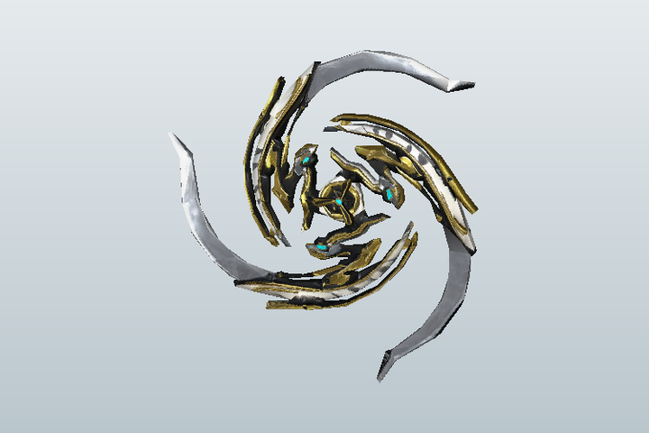 | 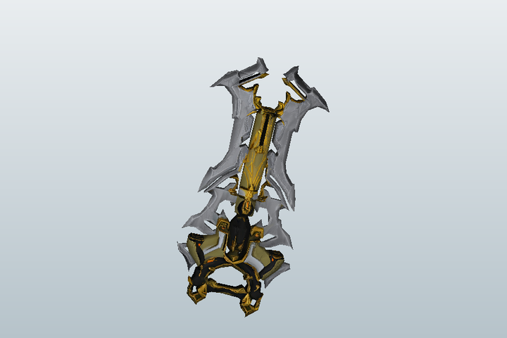 | 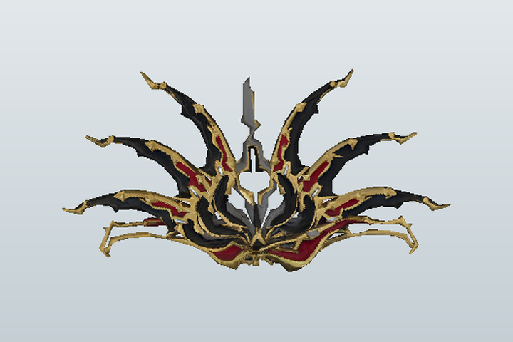 |

### Glaive Prime

Hold right-click for one second and release to throw. The disc ricochets off blocks and mobs, then returns when it reaches its collision limit or gets 64 blocks away from you. Use the special action in flight to detonate it and bring it back early. Sneak and right-click to toggle Volatile mode, which detonates on the first impact.

| First person | Third person |
| --- | --- |
| 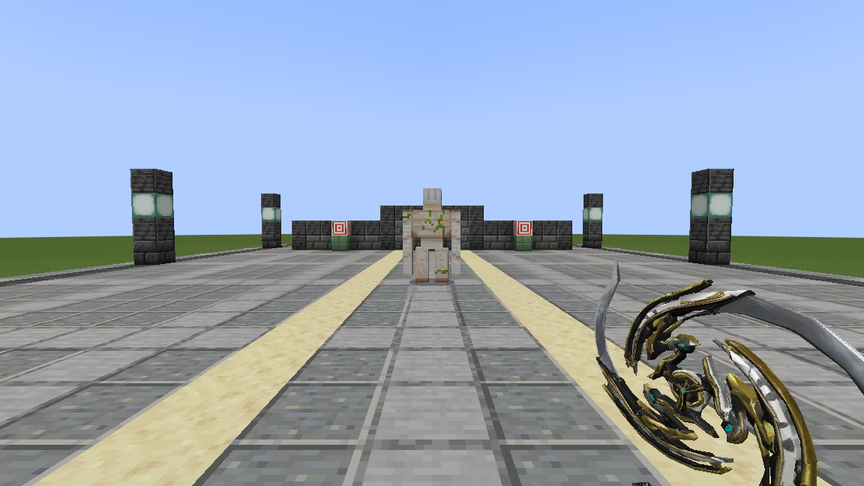 | 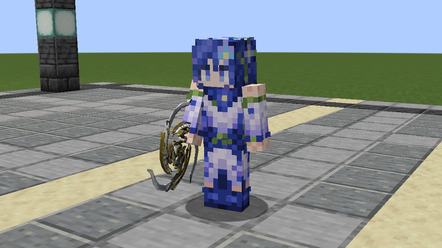 |
| 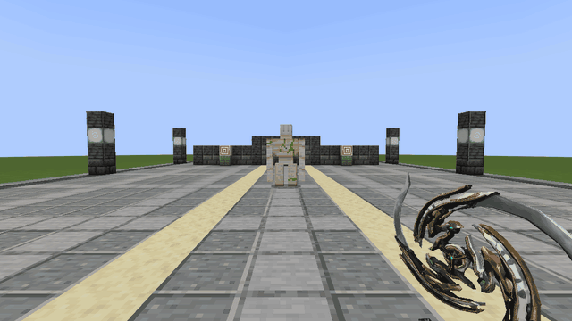 | 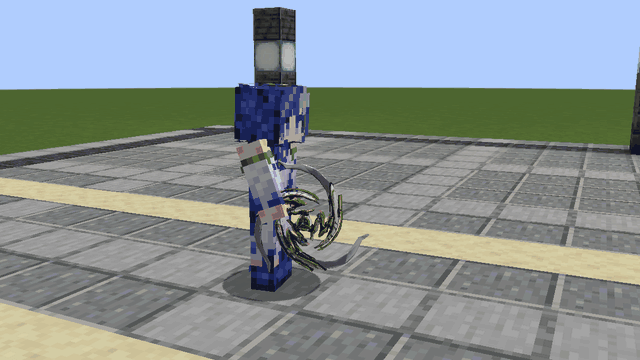 |

### Redeemer Prime

The gunblade fires ten pellets in a circular spread with its special action. It can fire three shots in quick succession, and each chamber reloads independently.

| First person | Third person |
| --- | --- |
| 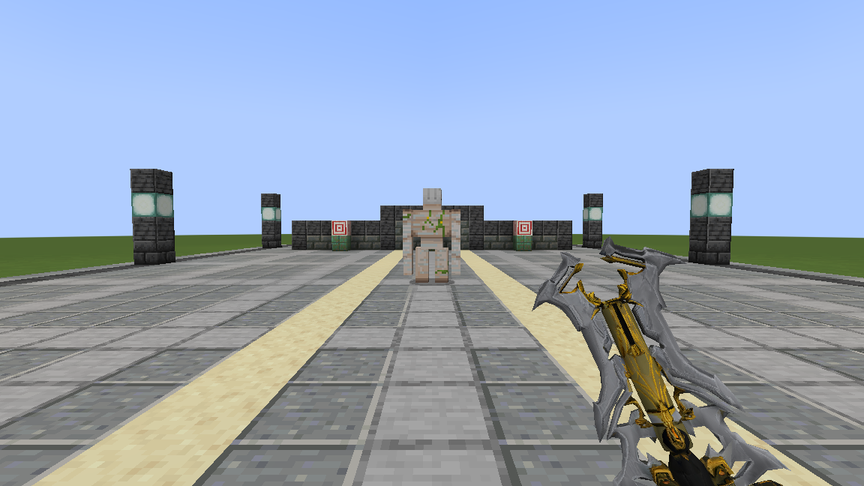 | 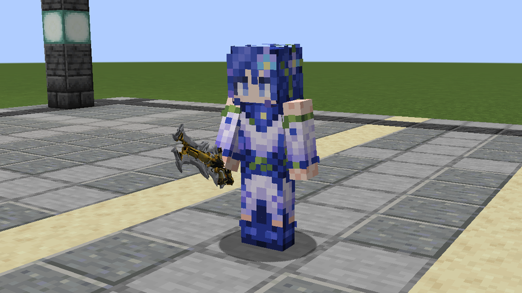 |
|  | 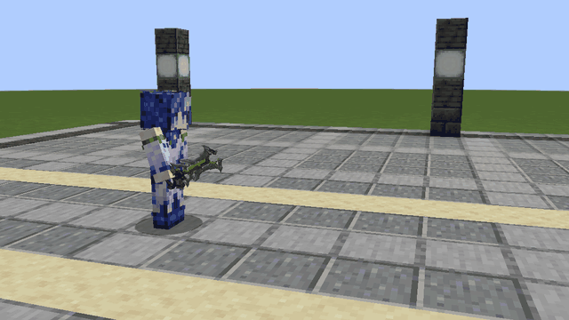 |

### Quassus Prime

Hold the warfans in your main hand with your off hand free to wield the pair. The special action throws horizontal blade volleys of 18 and 9 blades in succession. Each volley has its own reload timer.

| First person | Third person |
| --- | --- |
| 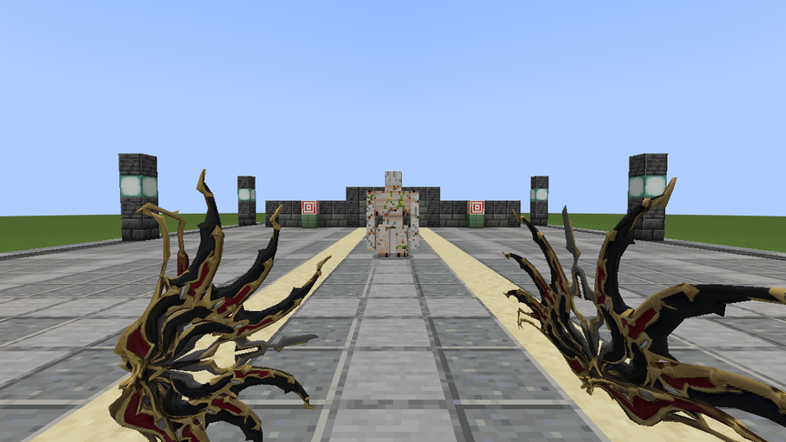 | 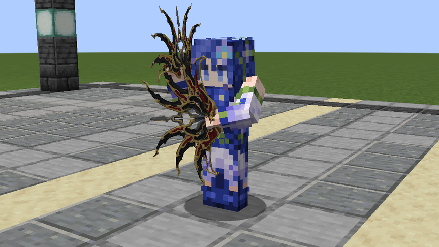 |
|  | 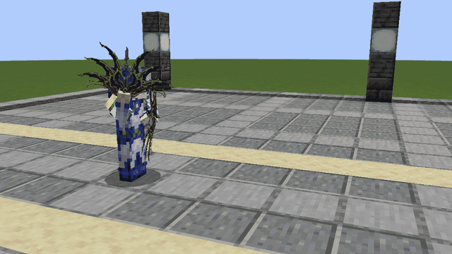 |

## How to obtain them

Drink an Ominous Bottle and approach a Trial Spawner in a Trial Chamber to start an Ominous Trial. Each Ominous Trial Spawner chooses either keys (30%) or consumables (70%) for the round, then ejects one reward per player it recorded. Use an Ominous Trial Key to open an Ominous Vault you have yet to unlock.

| Source | Chance of any Tennory weapon | Chance of a specific weapon |
| --- | ---: | ---: |
| Opening an Ominous Vault | 7.5% | 2.5% |
| One Ominous Trial Spawner consumable reward | 2% | about 0.67% |
| Clearing one Ominous Trial Spawner solo, from the spawner itself | 1.4% | about 0.47% |

Each successful bonus roll gives one uniformly selected weapon from the `TennoryWeaponPool`, in addition to the vanilla rewards. A vault can give both a Heavy Core and a weapon on the same opening. In multiplayer, a spawner that chooses consumables rolls the weapon bonus separately for each consumable reward it ejects.

All three weapons are also available in the Tennory creative tab.

## License

See [LICENSE.md](LICENSE.md).
